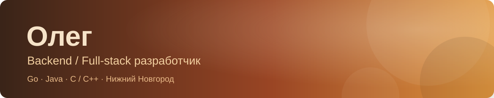

  

  <strong>Backend-разработка · системное программирование · full-stack</strong>

  Разрабатываю backend на <strong>Go</strong> и <strong>Java</strong>, работаю с системными проектами на <strong>C/C++</strong> и расширяю навыки в сторону full-stack.

📍 Нижний Новгород

---

### 🧰 Технологии

<table>
  <tr>
    <td><strong>Языки</strong></td>
    <td>     </td>
  </tr>
  <tr>
    <td><strong>Бэкенд и данные</strong></td>
    <td> </td>
  </tr>
  <tr>
    <td><strong>Фронтенд и UI</strong></td>
    <td>     </td>
  </tr>
  <tr>
    <td><strong>Инфраструктура</strong></td>
    <td> </td>
  </tr>
  <tr>
    <td><strong>Инструменты</strong></td>
    <td>   </td>
  </tr>
</table>

### 🎓 Образование

**ИРИТ НГТУ им. Р. Е. Алексеева**  
Направление: «Информатика и вычислительная техника»  
Профиль: «Программное обеспечение»

### 🤝 Командная разработка

Есть опыт командной разработки в рамках НИР: совместная работа над задачами, обсуждение технических решений и согласование результатов.

### 🧠 ИИ и учебная практика

- **Разработка с ИИ:** использую [Claude Code](https://code.claude.com/docs/en/overview) для прототипирования небольших игр и создания автоматизаций; проверяю и дорабатываю сгенерированный код.
- **Машинное обучение:** в рамках учебного курса запускал и обучал нейронные сети.

### ☕ Контакты

  
  &nbsp;
  

  Спокойно, последовательно, один проект за другим. ☕

